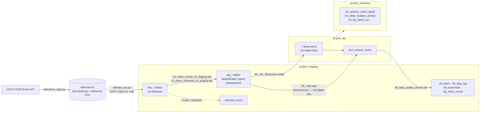
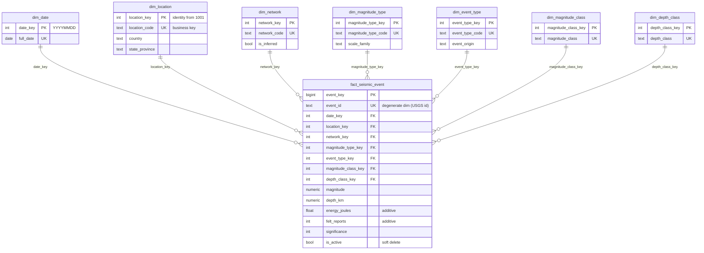

# Seismo DW — Global Seismic Event Data Warehouse (PostgreSQL)

DL3004 Data Warehousing & Business Intelligence Lab — FAST-NUCES Lahore, Fall 2026.

A physical data warehouse and ETL pipeline over **real USGS earthquake data**
(2024-01-01 → 2026-11-14, magnitude ≥ 2.5): **79,975 fact rows**, 7 surrogate-key dimensions,
a staging layer with full cleaning and quarantine, and 40 automated data-quality checks.

The warehouse is the PostgreSQL re-implementation of **Seismo**, our Databricks lakehouse project
(Bronze → Silver → Gold). The medallion layers map onto the DW layers required by the course:

| Seismo (Databricks / Delta) | Seismo DW (PostgreSQL) |
|---|---|
| `bronze_seismic_events` (raw GeoJSON, SCD2) | `project_staging.raw_usgs_event` (raw JSONB, immutable, per-batch hash) |
| `silver_seismic_events` + quarantine | `project_staging.stg_seismic_event` + `rejected_event` |
| Gold star schema (`gold_dim_*`, `gold_fact_*`) | `project_dw` star schema with PostgreSQL identity surrogate keys |
| Gold BI views / daily summary | `project_reporting` views + materialized view |
| `pipeline_execution_log` | `etl_batch`, `etl_step_log`, `dq_check_result` |

---

## Phase 2 deliverables → where they are

| Deliverable | Location |
|---|---|
| PostgreSQL database SQL scripts | [`sql/`](sql) (run order below), master script [`sql/run_all.sql`](sql/run_all.sql) |
| Staging Schema SQL | [`sql/staging/02_staging_schema.sql`](sql/staging/02_staging_schema.sql) |
| DW Schema SQL | [`sql/dw/03_dw_schema.sql`](sql/dw/03_dw_schema.sql) (+ reporting layer [`sql/reporting/04_reporting_schema.sql`](sql/reporting/04_reporting_schema.sql)) |
| ETL Scripts SQL/Python | Python: [`etl/`](etl) · SQL: [`sql/staging/11_clean_reference_to_staging.sql`](sql/staging/11_clean_reference_to_staging.sql), [`sql/staging/12_clean_events_to_staging.sql`](sql/staging/12_clean_events_to_staging.sql) |
| Data Cleaning Report PDF | [`docs/phase2/Data_Cleaning_Report.pdf`](docs/phase2/Data_Cleaning_Report.pdf) |
| Dimension Load Scripts SQL | [`sql/dimensions/`](sql/dimensions) (`20_` … `26_`) |
| Fact Load Scripts SQL | [`sql/facts/30_load_fact_seismic_event.sql`](sql/facts/30_load_fact_seismic_event.sql) |
| Data Quality Report PDF | [`docs/phase2/Data_Quality_Report.pdf`](docs/phase2/Data_Quality_Report.pdf) · checks: [`sql/quality/`](sql/quality) |
| GitHub repository | this repository |

Requirement-by-requirement mapping (PDF sections 1–6 and the marking rubric):
[`docs/phase2/Phase2_Implementation_Guide.md`](docs/phase2/Phase2_Implementation_Guide.md).

---

## Architecture



ELT style (Lab 07): Python only extracts and bulk-loads files unchanged; every transformation runs in
PostgreSQL SQL. Each batch runs in two transactions (raw load, then stage → dimensions → fact → quality),
so a failure rolls the warehouse back completely and marks the batch `FAILED`.

## Star schema (`project_dw`)

Grain: **one row per USGS seismic event** (latest version).



Surrogate keys are generated by PostgreSQL (`GENERATED BY DEFAULT AS IDENTITY (START WITH 1001)`), business keys
are kept with `UNIQUE` constraints, every dimension has an Unknown member `-1`, and the fact stores surrogate keys only.

---

## Running it

Prerequisites: PostgreSQL 14+ (developed on 18), Python 3.10+.

```bash
pip install -r requirements.txt
cp .env.example .env          # then set PGPASSWORD etc. for your server
python -m etl.run_pipeline all
python -m etl.build_reports   # regenerates the two PDFs from the loaded database
```

`all` = `init --reset` → `run` (8 source files in manifest order) → `rerun-demo` → `quality` → `evidence`.
It takes about 80 seconds and prints a per-step row count log. Individual commands:

| Command | What it does |
|---|---|
| `python -m etl.run_pipeline init [--reset]` | create database `seismo_dw`, the 3 schemas and all tables |
| `python -m etl.run_pipeline run` | load every file in `etl/config.py:MANIFEST` (files already loaded are skipped by SHA-256) |
| `python -m etl.run_pipeline load FILE --type INCREMENTAL [--force]` | load one file as a new batch |
| `python -m etl.run_pipeline rerun-demo` | reload the 2026 batch unchanged and prove the fact does not change |
| `python -m etl.run_pipeline quality` | run the 40 data-quality checks |
| `python -m etl.run_pipeline evidence` | export query outputs to `evidence/` |
| `python -m etl.extract_usgs --start 2026-11-01 --end 2026-12-01 --out data/source/x.geojson.gz` | pull a new extract from the USGS API |

pgAdmin / psql users: after the raw files are landed, `psql -d seismo_dw -v batch=<id> -f sql/run_all.sql`
re-runs the whole SQL chain for one batch.

### SQL run order

| # | Script | Layer |
|---|---|---|
| 00 | `sql/00_create_database.sql` | database |
| 01 | `sql/01_create_schemas.sql` | `project_staging`, `project_dw`, `project_reporting` |
| 02 | `sql/staging/02_staging_schema.sql` | staging DDL (raw, stg, control, quarantine, DQ) |
| 03 | `sql/dw/03_dw_schema.sql` | warehouse DDL (dimensions, fact, PK/FK/UNIQUE/CHECK, indexes) |
| 04 | `sql/reporting/04_reporting_schema.sql` | reporting views |
| 10 | `sql/staging/10_profile_raw_data.sql` | profiling queries (read-only) |
| 11 | `sql/staging/11_clean_reference_to_staging.sql` | ETL: reference CSV → stg |
| 12 | `sql/staging/12_clean_events_to_staging.sql` | ETL: events → stg (dedupe, NULLs, text, types, quarantine) |
| 20–26 | `sql/dimensions/*.sql` | dimension loads |
| 30 | `sql/facts/30_load_fact_seismic_event.sql` | fact load (surrogate-key mapping, idempotent upsert) |
| 40 | `sql/quality/40_data_quality_checks.sql` | data-quality checks → `dq_check_result` |
| 41 | `sql/quality/41_validation_and_analysis.sql` | reconciliation, broken-load simulation, analytical queries |

## Results of the current load

| | |
|---|---|
| Raw rows landed (9 event batches incl. one deliberate re-run) | 109,030 |
| Rows quarantined (with reason) | 67 |
| Fact rows (`fact_seismic_event`) | 79,975 |
| `dim_location` / `dim_date` rows | 299 / 1,096 |
| Data-quality checks | 33 PASS · 0 FAIL · 7 INFO |
| Re-run of an already loaded batch | 0 inserted · 0 updated · totals identical |

Evidence files (CSV query outputs, constraint-violation test, rerun proof) are in [`evidence/`](evidence).

## Repository layout

```
seismo-dw/
├── data/source/        source files: 4 USGS GeoJSON extracts (gzip) + 4 reference CSVs
├── etl/                Python: extract_usgs, load_raw, run_pipeline (orchestrator), build_reports, config
├── sql/                all PostgreSQL scripts (schemas, ETL, dimension + fact loads, quality)
├── docs/phase2/        Phase 2 reports (PDF) and implementation guide
├── docs/phase3/        reserved for Phase 3 (OLAP, dashboards)
└── evidence/           exported query outputs proving reconciliation, integrity and idempotency
```

Data source: [USGS FDSN Event Web Service](https://earthquake.usgs.gov/fdsnws/event/1/) — public domain.
